# CNN em Verilog/SystemVerilog

<p align="center">
  <a href="images/render.png">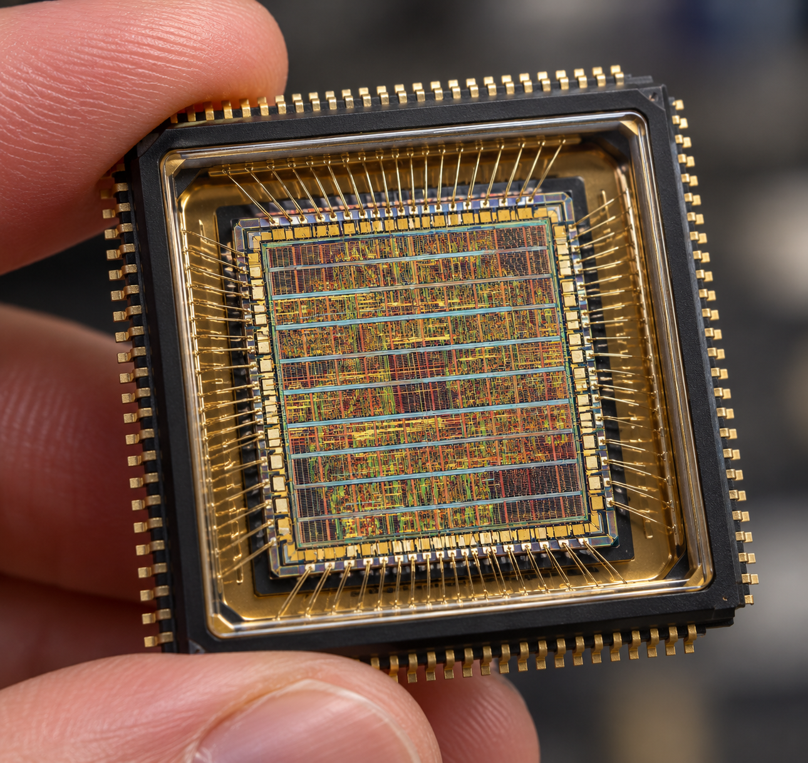</a>
  <br />
  <em>Render ilustrativo do projeto CNN.</em>
</p>

<div align="justify">

Implementação de uma rede neural convolucional em hardware, com duas camadas
convolucionais, quantização, ativação ReLU, max pooling e duas camadas totalmente
conectadas. O repositório reúne os módulos SystemVerilog, as bancadas de
verificação, os scripts de simulação e os resultados de implementação física.

O módulo de topo é `CNN`; `CNN_top` identifica suas bancadas e pastas de
resultados. Os pesos e os biases são fornecidos pelas entradas do topo.

## Arquitetura

```text
Imagem → Conv1 → Quantização → ReLU → MaxPool
       → Conv2 → Quantização → ReLU → MaxPool
       → Flatten → FC1 → FC2 → Vetor de saída
```

Cada filtro convolucional usa um kernel por canal de entrada. Os produtos
calculados nas janelas são somados entre os canais, juntamente com o bias,
para formar um mapa de características. Filtros diferentes produzem mapas
diferentes, que constituem os canais de entrada da próxima camada.

O max pooling seleciona o maior valor de cada região 2 × 2. O flatten reorganiza
os mapas em um vetor, usado pelas camadas totalmente conectadas. Cada neurônio
calcula uma soma ponderada com bias e ativação.

<p align="center">
  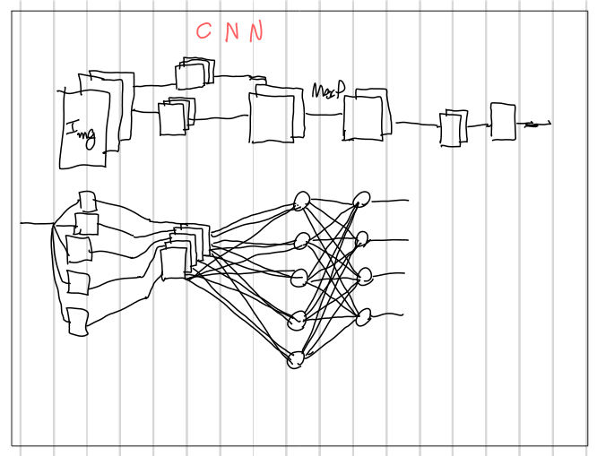
</p>

<table align="center">
<thead>
<tr>
<th>Bloco</th>
<th>Função</th>
<th>Arquivo</th>
</tr>
</thead>
<tbody>
<tr>
<td>DotProduct</td>
<td>Produto interno entre vetores de entradas e pesos</td>
<td><code>src/DotProduct/DotProduct.sv</code></td>
</tr>
<tr>
<td>Convolution</td>
<td>Somas de produtos entre um kernel e as janelas de um canal</td>
<td><code>src/Convolution/Convolution.sv</code></td>
</tr>
<tr>
<td>FeatureMap</td>
<td>Combinação das contribuições dos canais e do bias de um filtro</td>
<td><code>src/FeatureMap.sv</code></td>
</tr>
<tr>
<td>ConvLayer</td>
<td>Organização dos filtros de uma camada</td>
<td><code>src/ConvLayer.sv</code></td>
</tr>
<tr>
<td>Quantizer</td>
<td>Reescala e redução da largura dos resultados aritméticos</td>
<td><code>src/Quantizer.sv</code></td>
</tr>
<tr>
<td>ReLU</td>
<td>Substituição de valores negativos por zero</td>
<td><code>src/ReLU/ReLU.sv</code></td>
</tr>
<tr>
<td>MaxPooling</td>
<td>Redução espacial por seleção do máximo</td>
<td><code>src/MaxPooling.sv</code></td>
</tr>
<tr>
<td>Flatten</td>
<td>Reorganização dos mapas em vetor</td>
<td><code>src/Flatten.sv</code></td>
</tr>
<tr>
<td>Neuron / FCLayer</td>
<td>Neurônios e camada totalmente conectada</td>
<td><code>src/Neuron.sv</code>, <code>src/FCLayer.sv</code></td>
</tr>
<tr>
<td>CNN</td>
<td>Conexão das camadas e interface do topo</td>
<td><code>src/CNN.sv</code></td>
</tr>
</tbody>
</table>

A descrição funcional está em [Notas do bloco CNN](docs/CNN_block_notes.pdf).
O [guia de referências](docs/README.md) organiza os materiais de apoio e
explica como eles se relacionam com o projeto.

## Organização do repositório

```text
CNN/
├── src/                       # Módulos SystemVerilog
├── docs/                      # Notas de arquitetura e bibliografia
├── images/                    # Diagramas e imagens do projeto
├── oneware_project_folder/    # Projeto para o ambiente OneWare
├── synth_org/                 # Fluxo e resultados de síntese por bloco
├── scripts/
│   ├── synth/
│   ├── testbenchs/
│   └── UVM/
├── testbenchs/                # Bancadas de simulação sem UVM
├── UVM/                       # Ambientes UVM e relatórios de verificação
├── results_tb/                # Saídas geradas pelas bancadas sem UVM
├── results_uvm/               # Saídas geradas pelas bancadas UVM
└── waveform/                  # Formas de onda do topo UVM em FST
```

Os diretórios de resultados são gerados pelos scripts e podem não existir em
um checkout novo. `synth_org/` contém as pastas `arithmetic`, `convolution`,
`fully_connected`, `pooling`, `reshape` e `top`.

## Verificação do topo

A campanha usa uma configuração reduzida, com imagem 4 × 4 de um canal,
operandos signed de 8 bits, kernels 3 × 3, dois filtros por camada
convolucional e dois neurônios em cada FC. Padding e shifts são iguais a 1.
Essa configuração permite verificar a cadeia completa com estímulos sintéticos;
ela não estabelece os valores padrão de todas as versões do projeto.

O modelo de referência calcula as duas saídas esperadas a partir das entradas.
O scoreboard compara o vetor quando `valid_out4` está ativo. A observação
funcional é limitada às portas públicas; a cobertura estrutural do RTL é
instrumentada automaticamente pelo simulador.

Os testes verificam a aritmética e o protocolo da configuração executada.
Não medem a acurácia de um modelo treinado: os valores de `result_FC2` não são
tratados como probabilidades ou rótulos de um conjunto de imagens reais.

### Executar a bancada UVM

A partir da raiz do repositório, com Verilator, compilador C++, Make, Python 3
e LCOV instalados:

```bash
# Instalar a biblioteca UVM usada pelo projeto.
bash scripts/UVM/bash/CNN_top/uvm_cnn_top.sh setup_uvm

# Simular um cenário.
bash scripts/UVM/bash/CNN_top/uvm_cnn_top.sh run TEST=IMG-01

# Executar a campanha completa e gerar os relatórios de cobertura.
bash scripts/UVM/bash/CNN_top/uvm_cnn_top.sh coverage
```

O fluxo foi validado com Verilator 5.052 e UVM 2017-1.0. O dump é gerado em
`waveform/CNN_top_UVM.fst`, com profundidade 1 e as IOs públicas do topo.
O [guia da bancada UVM](UVM/CNN_top/README_UVM.md) descreve as dependências,
os controles de execução e os arquivos de saída. A
[bancada sem UVM](testbenchs/CNN_top/README.md) possui fluxos para Icarus e
Verilator.

### Executar UVM + RTL no xezim

O fluxo alternativo usa os mesmos arquivos RTL, a mesma bancada UVM e os
mesmos critérios de aprovação, com coleta nativa de `statement`, `branch`
e `toggle` no escopo `tb_cnn.dut`. Requer xezim, Make, Python 3 e a biblioteca
UVM instalada pelo setup acima.

```bash
# Teste curto com cobertura e waveform próprias.
bash scripts/UVM/bash/CNN_top/uvm_cnn_top_xezim.sh coverage TEST=IMG-01

# Campanha completa: 1.000 transações aleatórias + 100 dirigidas.
bash scripts/UVM/bash/CNN_top/uvm_cnn_top_xezim.sh coverage \
  TEST=ALL RANDOM_COUNT=1000 SEED=20261025

# Regenerar o HTML a partir do banco já coletado, sem simular.
bash scripts/UVM/bash/CNN_top/uvm_cnn_top_xezim.sh report
```

O HTML fica em `results_uvm/CNN_top_xezim/coverage/index.html`, com cartões
de métricas, resultado UVM, busca e ordenação por módulo e downloads dos
dados por instância e dos pontos não cobertos. O layout é compartilhado com
o relatório xezim da netlist com SDF e funciona localmente, sem dependências
externas. A apresentação é uma automação do projeto sobre o banco nativo
`xezim_cov.json`, não um emissor HTML do xezim.

Os logs e o CSV ficam em `results_uvm/CNN_top_xezim/`, e a waveform usa
`waveform/CNN_top_UVM_RTL_XEZIM.fst`. Os resultados do Verilator continuam
em `results_uvm/CNN_top/`; os da netlist em `results_uvm/CNN_top_sdf/`.
`ENABLE_WAVEFORM=0` desativa o dump e `ENABLE_COVERAGE=0` desativa a
instrumentação no alvo `run`. Um resultado FAIL mantém o retorno de erro e
ainda gera cobertura quando o banco está disponível.

Para comparar os simuladores, execute `coverage` com os mesmos `TEST`,
`RANDOM_COUNT` e `SEED` nos scripts `uvm_cnn_top.sh` e
`uvm_cnn_top_xezim.sh`. Compare primeiro os vetores esperados/observados,
status e latências nos CSVs. Os percentuais de cobertura exigem atenção aos
denominadores: instruções do xezim não equivalem a linhas do Verilator,
e as regras de instrumentação de ramos e toggles também podem diferir.

#### Relatório de cobertura UVM + RTL

A captura da campanha completa no xezim mostra 98,44% de statement,
92,98% de branch e 55,59% de toggle. Foram registrados 1.083 PASS, duas
FAIL, três cancelamentos por reset e 12 INCOMPLETE em 1.100 starts.
Os percentuais de cobertura não substituem o resultado funcional **FAIL**.

<p align="center">
  <a href="images/rtl_coverage.png">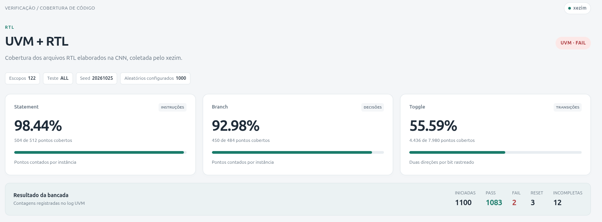</a>
  <br />
  <em>Cobertura RTL — Totais por instância e resultado da bancada UVM no xezim.</em>
</p>

### Resultado registrado em 25/10/2026

<table align="center">
<thead>
<tr>
<th>Indicador</th>
<th align="right">Resultado</th>
</tr>
</thead>
<tbody>
<tr>
<td>Cenários executados</td>
<td align="right">22, de IMG-00 a IMG-21</td>
</tr>
<tr>
<td>Transações iniciadas</td>
<td align="right">1.100</td>
</tr>
<tr>
<td>PASS / FAIL</td>
<td align="right">1.083 / 2</td>
</tr>
<tr>
<td>Canceladas intencionalmente por reset</td>
<td align="right">3</td>
</tr>
<tr>
<td>INCOMPLETE, por sobreposição exploratória</td>
<td align="right">12</td>
</tr>
<tr>
<td>Latência observada das 1.085 respostas comparadas</td>
<td align="right">37 ciclos</td>
</tr>
<tr>
<td>Resultado global</td>
<td align="right"><strong>FAIL</strong></td>
</tr>
</tbody>
</table>

As divergências ocorreram no IMG-00 com W03 e no IMG-16 com
`ConvBias2[0] = -45`. Os incompletos pertencem ao IMG-19, para o qual ainda
não há contrato de aceitação de imagens sobrepostas.

O [relatório de verificação](UVM/CNN_top/doc_verif/doc_verificacao_CNN_top.pdf)
contém a análise dos casos e da cobertura. O
[plano de verificação](UVM/CNN_top/req_verif_CNN_top.md) define os critérios;
as [evidências da campanha](UVM/CNN_top/doc_verif/evidencias/README.md)
registram os resultados. O clock da bancada tem período de 10 ns; os 37 ciclos
medidos correspondem a 370 ns e não representam uma exigência temporal já
confirmada para todas as configurações da CNN.

### Resultados com netlist e anotação SDF — 26/10/2026

A campanha completa da netlist final do OpenROAD ASAP7, com atrasos SDF,
foi executada no xezim 0.11.3 com a bancada UVM 2017-1.0. Foram utilizados
`6_final.v` e `6_final.sdf`, em `synth_org/top/results/asap7/top/base/`,
com `TEST=ALL`, `RANDOM_COUNT=1000`, `SEED=20261025` e clock de 10 ns.
Os 22 cenários totalizaram 1.000 transações aleatórias e 100 dirigidas.

Nesse fluxo, o DUT é a netlist `6_final.v`, compilada no xezim junto dos
modelos das células ASAP7 e da bancada UVM. O arquivo `6_final.sdf` é
anotado na instância do DUT para aplicar os atrasos do circuito implementado
pelo OpenROAD, usando os valores máximos de atraso (`--sdf-max`). O adaptador
de portas conecta os arrays da interface UVM aos vetores da netlist.

As sequências e o driver UVM fornecem imagens, kernels, pesos e biases;
o monitor captura as respostas e o scoreboard compara as saídas com o
modelo de referência, mantendo os critérios de verificação da bancada.
A waveform registra as IOs durante essa mesma simulação com SDF ativo.

<table align="center">
<thead>
<tr>
<th>Indicador</th>
<th align="right">Resultado com netlist e SDF</th>
</tr>
</thead>
<tbody>
<tr>
<td>Transações iniciadas</td>
<td align="right">1.100</td>
</tr>
<tr>
<td>PASS</td>
<td align="right">1.065</td>
</tr>
<tr>
<td>FAIL</td>
<td align="right">20</td>
</tr>
<tr>
<td>Canceladas por reset</td>
<td align="right">3</td>
</tr>
<tr>
<td>INCOMPLETE, por sobreposição exploratória</td>
<td align="right">12</td>
</tr>
<tr>
<td>Diferenças de dados nas saídas</td>
<td align="right">25</td>
</tr>
<tr>
<td>Respostas comparadas</td>
<td align="right">1.085</td>
</tr>
<tr>
<td>Latência observada</td>
<td align="right">38 ciclos — 380 ns</td>
</tr>
<tr>
<td>Sinais com atrasos SDF anotados</td>
<td align="right">155.094</td>
</tr>
<tr>
<td>Verificações temporais anotadas</td>
<td align="right">26.816</td>
</tr>
<tr>
<td>Resultado global</td>
<td align="right"><strong>FAIL</strong></td>
</tr>
</tbody>
</table>

<details>
<summary>Captura do resumo histórico com netlist e SDF</summary>

<p align="center">
  <a href="images/umv_sdf_report.png">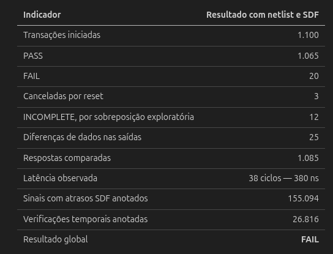</a>
  <br />
  <em>Resumo histórico — Captura dos resultados da campanha de 26/10/2026 apresentados na tabela acima.</em>
</p>

</details>

As duas divergências registradas na campanha RTL permaneceram, e 18 falhas
adicionais concentraram-se no conjunto de pesos W02. Os 1.000 aleatórios
passaram, mas as 20 falhas dirigidas mantiveram o resultado global **FAIL**.
Os três cancelamentos por reset foram intencionais, e os 12 casos de
sobreposição permaneceram exploratórios. A comparação com RTL envolve
outra representação do DUT e outro simulador; ela não isola o SDF como
causa das divergências.

O [relatório UVM com SDF](UVM/CNN_top/doc_verif_sdf/doc_verificacao_CNN_top_SDF.pdf)
apresenta todas as falhas, a comparação com RTL e as limitações de cobertura.
As [evidências preservadas](UVM/CNN_top/doc_verif_sdf/evidencias/README.md)
incluem os logs, o CSV, a auditoria dos verificadores e o manifesto SHA-256.
O [guia do fluxo](scripts/UVM/gate_level/README.md) descreve as dependências
e os ajustes de compatibilidade.

Para executar a campanha completa a partir da raiz do repositório:

```bash
bash scripts/UVM/bash/CNN_top/uvm_cnn_top_sdf.sh run \
  TEST=ALL RANDOM_COUNT=1000 SEED=20261025
```

Nas novas execuções, a geração de waveform está habilitada por padrão. O
fluxo com netlist e SDF grava `waveform/CNN_top_UVM_SDF.fst`, com as IOs
da interface e os atrasos anotados. A waveform RTL usa o arquivo distinto
`waveform/CNN_top_UVM.fst`. O dump SDF fica disponível também quando a
campanha termina em FAIL. Para abri-lo:

```bash
gtkwave waveform/CNN_top_UVM_SDF.fst
```

O script também habilita **code coverage** no xezim por padrão: instruções
(`statement`), decisões (`branch`) e transições de bits (`toggle`), limitadas
ao DUT `tb_cnn.dut` e suas células. Após a simulação, inclusive em caso de
FAIL, o banco `results_uvm/CNN_top_sdf/xezim_cov.json` é convertido no
relatório `results_uvm/CNN_top_sdf/coverage/index.html`, com resumo e CSVs
dos pontos não cobertos. Essa cobertura corresponde à netlist e aos modelos
de células; a campanha histórica acima não coletou essas métricas.
O [guia do fluxo](scripts/UVM/gate_level/README.md#code-coverage-no-xezim)
descreve as opções e o alvo `report`, que regenera o relatório sem simular.

### Cobertura da execução com netlist e SDF

A nova captura do painel SDF registra **91,34% de toggle**
(392.284/429.468 direções de transição), em 47.448 escopos. Statement e
branch aparecem como **N/A**, pois o xezim informou zero pontos nessas
métricas para esta netlist e seus modelos de células.

Nessa execução com coleta de cobertura, o log registra 1.067 PASS,
18 FAIL, três cancelamentos por reset e 12 INCOMPLETE, totalizando
1.100 starts. As 1.085 respostas comparadas tiveram latência de 38 ciclos,
e o resultado global permaneceu **FAIL**. Esse registro corresponde à
captura abaixo; o resumo e o PDF históricos acima preservam a campanha
anterior, com 1.065 PASS e 20 FAIL.

<p align="center">
  <a href="images/sdf_uvm_cov.png">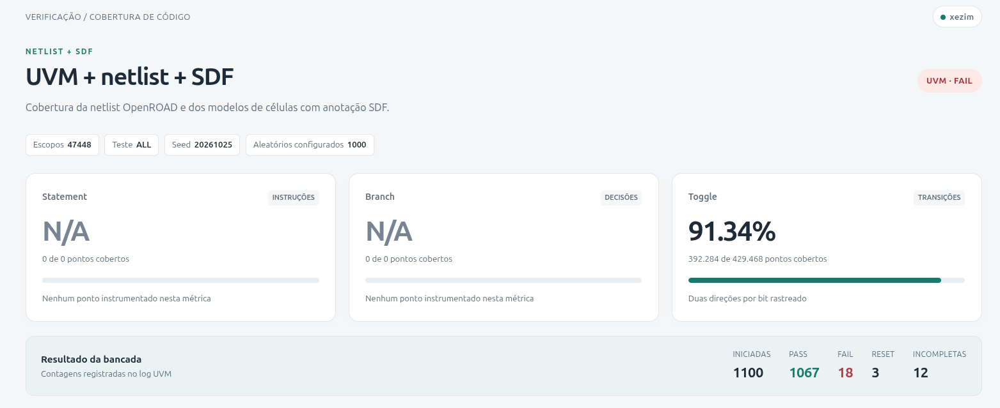</a>
  <br />
  <em>Cobertura com SDF — Painel gerado a partir do banco nativo do xezim, com as contagens da execução com coleta de cobertura.</em>
</p>

<details>
<summary>Captura da apresentação anterior do relatório de cobertura SDF</summary>

<p align="center">
  <a href="images/cov_xezim_report.png">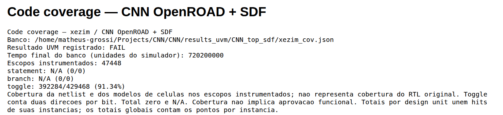</a>
  <br />
  <em>Apresentação anterior — Os mesmos totais de cobertura SDF, antes da atualização do layout HTML.</em>
</p>

</details>

Para atualizar o painel a partir do banco já coletado:

```bash
bash scripts/UVM/bash/CNN_top/uvm_cnn_top_sdf.sh report
```

### Forma de onda da simulação com SDF

A captura abaixo é um recorte de `waveform/CNN_top_UVM_SDF.fst`, no
intervalo de aproximadamente 0 a 50 µs. Ela mostra o reset, os pulsos de
`start`, os 16 pixels da imagem e parte dos parâmetros aplicados à netlist
durante a execução UVM com anotação SDF. Clique para abrir no tamanho original.

<p align="center">
  <a href="images/wav_sdf.png">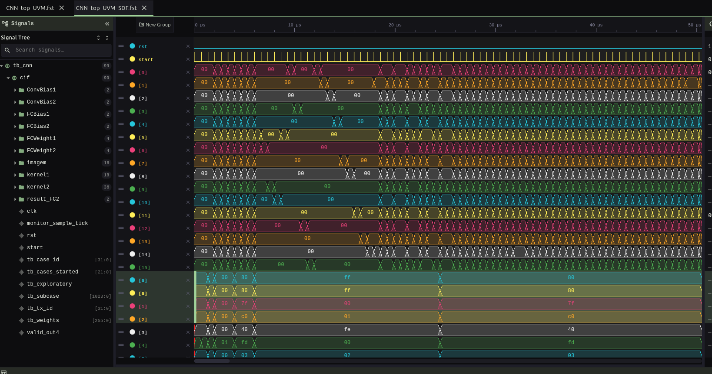</a>
  <br />
  <em>Waveform SDF — Estímulos da bancada UVM aplicados à netlist do OpenROAD com os atrasos SDF ativos.</em>
</p>

### Formas de onda da simulação RTL

As capturas abaixo foram obtidas no GTKWave a partir de
`waveform/CNN_top_UVM.fst`, com observação das IOs públicas da bancada.
Os barramentos aparecem em hexadecimal: por exemplo, `7F` representa 127 e
`80` representa −128 para um operando signed de 8 bits. A aprovação dos
resultados é registrada pelo scoreboard nos logs e no CSV.
Clique nas capturas para abri-las no tamanho original.

<p align="center">
  <a href="images/wav1.png">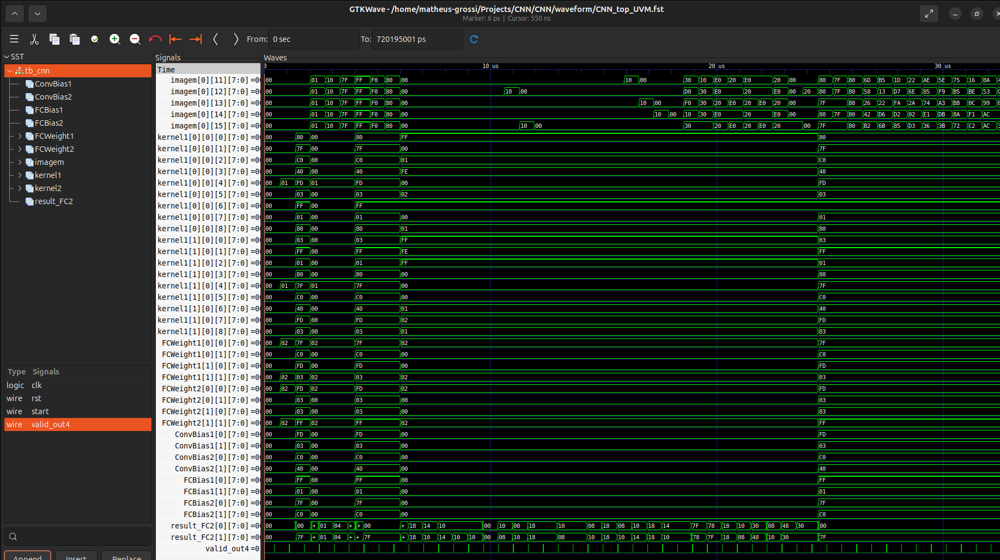</a>
  <br />
  <em>Waveform 1 — Primeiros estímulos e respostas. Trecho inicial com pixels, kernels, pesos das FCs e biases. Na parte inferior, aparecem as duas saídas e os pulsos de valid_out4.</em>
</p>

<p align="center">
  <a href="images/wav2.png">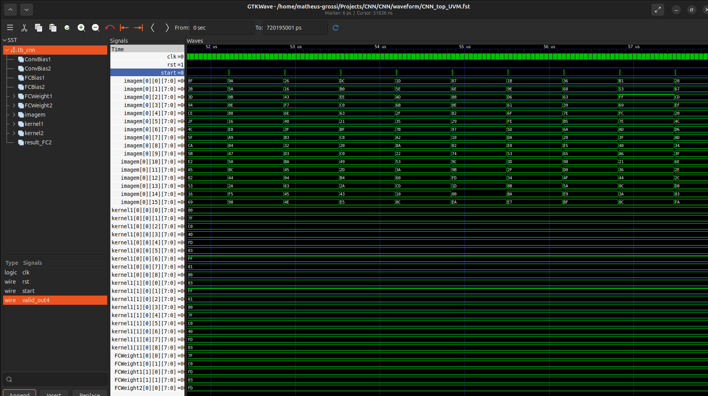</a>
  <br />
  <em>Waveform 2 — Ampliação dos estímulos de imagem. Intervalo em torno de 52–57 µs, com clock, start e os 16 pixels da entrada. Os kernels e pesos exibidos permanecem estáveis nesse trecho.</em>
</p>

<p align="center">
  <a href="images/wav3.png">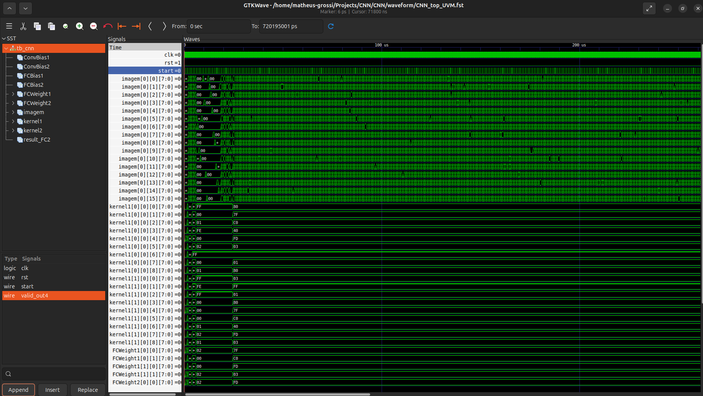</a>
  <br />
  <em>Waveform 3 — Panorama da sequência de imagens. Visão em escala de centenas de microssegundos, destacando a sucessão de starts e as alterações dos pixels ao longo da campanha.</em>
</p>

<p align="center">
  <a href="images/wav4.png">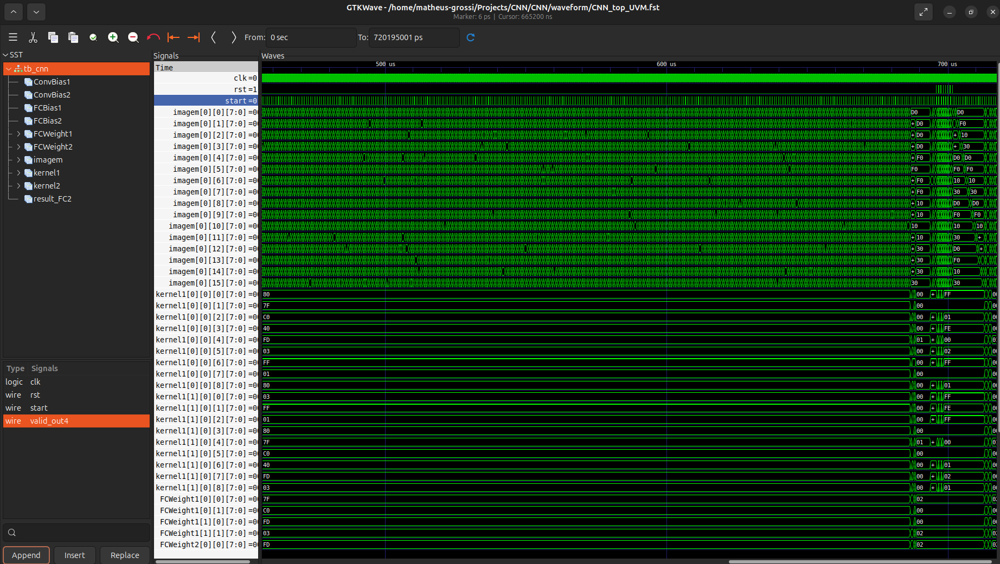</a>
  <br />
  <em>Waveform 4 — Controles no trecho final da campanha. Clock, reset, start e pixels no trecho final. A captura permite localizar pulsos de reset e mudanças dos conjuntos de pesos.</em>
</p>

<p align="center">
  <a href="images/wav5.png">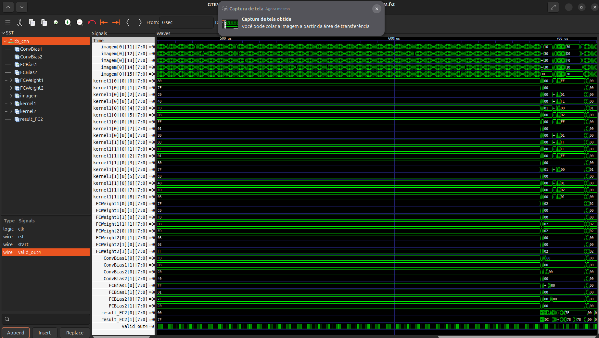</a>
  <br />
  <em>Waveform 5 — Pesos, biases e saídas no trecho final. Detalhe dos pesos, biases, result_FC2 e valid_out4, útil para relacionar a configuração aplicada com os eventos de resposta válida.</em>
</p>

## Síntese e implementação física

Os resultados do topo para a biblioteca ASAP7 estão em
`synth_org/top/reports/asap7/top/base/`. As métricas abaixo foram conferidas
nos arquivos `synth_stat.txt` e `6_finish.rpt` desse diretório.

<table align="center">
<thead>
<tr>
<th>Indicador</th>
<th align="right">Valor no relatório</th>
</tr>
</thead>
<tbody>
<tr>
<td>Células após síntese lógica</td>
<td align="right">47.470</td>
</tr>
<tr>
<td>Área de células, campo <code>Chip area</code></td>
<td align="right"><code>5259.006000</code></td>
</tr>
<tr>
<td>Violações de setup / hold</td>
<td align="right">0 / 0</td>
</tr>
<tr>
<td>Potência total estimada</td>
<td align="right"><code>1.05e-02 W</code> — aproximadamente 10,5 mW</td>
</tr>
</tbody>
</table>

### Tipos e quantidade de células

O trecho a seguir foi extraído de
[synth_stat.txt](synth_org/top/reports/asap7/top/base/synth_stat.txt).
Ele apresenta o total de células, alguns tipos representativos e a área
reportada pelo Yosys. Os marcadores `[...]` indicam linhas omitidas; o arquivo
completo contém os demais tipos.
As áreas mantêm o formato e as unidades do relatório de síntese.

```text
=== CNN ===

        +----------------------------Count including submodules.
        |        +-------------------Area including submodules.
        |        |        +----------Local count, excluding submodules.
        |        |        |        +-Local area, excluding submodules.
        |        |        |        |
[...]
    47470 5.26E+03    47470 5.26E+03 cells
     3039  265.852     3039  265.852   AND2x2_ASAP7_75t_R
[...]
     1242   90.542     1242   90.542   BUFx2_ASAP7_75t_R
[...]
     3352  977.443     3352  977.443   DFFHQNx1_ASAP7_75t_R
     2728  556.839     2728  556.839   FAx1_ASAP7_75t_R
     4432  581.567     4432  581.567   HAxp5_ASAP7_75t_R
    12883  563.502    12883  563.502   INVx1_ASAP7_75t_R
     1931  168.924     1931  168.924   NAND2x1_ASAP7_75t_R
[...]
     1364  119.323     1364  119.323   NOR2x1_ASAP7_75t_R
[...]
     4915  501.625     4915  501.625   OA21x2_ASAP7_75t_R
[...]
     1674  268.476     1674  268.476   XOR2x2_ASAP7_75t_R
[...]
   Chip area for module '\CNN': 5259.006000
     of which used for sequential elements: 977.443200 (18.59%)
```

As células `DFF` são elementos sequenciais; `FA` e `HA` são somadores
completos e meios somadores. `INV` e `BUF` são inversores e buffers, enquanto
`AND`, `NAND`, `NOR`, `OA` e `XOR` implementam funções combinacionais.
A participação dos elementos sequenciais na área reportada é de 18,59%.

### Fechamento de timing

O relatório final do OpenROAD registra TNS e WNS iguais a zero e folga
positiva na análise de atraso máximo. Os contadores de violações de setup
e hold também são zero. Abaixo estão os trechos correspondentes de
[6_finish.rpt](synth_org/top/reports/asap7/top/base/6_finish.rpt):

```text
==========================================================================
finish report_tns
--------------------------------------------------------------------------
tns max 0.00

==========================================================================
finish report_wns
--------------------------------------------------------------------------
wns max 0.00

==========================================================================
finish report_worst_slack
--------------------------------------------------------------------------
worst slack max 5497.88
[...]
==========================================================================
finish setup_violation_count
--------------------------------------------------------------------------
setup violation count 0

==========================================================================
finish hold_violation_count
--------------------------------------------------------------------------
hold violation count 0
```

TNS resume a soma das folgas negativas e WNS indica a pior folga negativa;
ambos aparecem zerados nesta execução. O valor de `worst slack max` é
reproduzido na unidade temporal adotada pelo fluxo. Esses indicadores
documentam o atendimento às restrições de timing avaliadas; o resultado
funcional da campanha UVM permanece apresentado na seção de verificação.

### Estimativa de potência

O resumo de potência do OpenROAD distribui a estimativa assim:

<table align="center">
<thead>
<tr>
<th>Grupo</th>
<th align="right">Internal (W)</th>
<th align="right">Switching (W)</th>
<th align="right">Leakage (W)</th>
<th align="right">Total (W)</th>
<th align="right">Participação</th>
</tr>
</thead>
<tbody>
<tr>
<td>Sequential</td>
<td align="right">1.13e-03</td>
<td align="right">7.18e-05</td>
<td align="right">5.11e-07</td>
<td align="right">1.21e-03</td>
<td align="right">11,4%</td>
</tr>
<tr>
<td>Combinational</td>
<td align="right">4.51e-03</td>
<td align="right">4.28e-03</td>
<td align="right">3.07e-06</td>
<td align="right">8.80e-03</td>
<td align="right">83,4%</td>
</tr>
<tr>
<td>Clock</td>
<td align="right">3.42e-04</td>
<td align="right">2.04e-04</td>
<td align="right">1.23e-07</td>
<td align="right">5.46e-04</td>
<td align="right">5,2%</td>
</tr>
<tr>
<td>Total</td>
<td align="right">5.98e-03</td>
<td align="right">4.56e-03</td>
<td align="right">3.71e-06</td>
<td align="right">1.05e-02</td>
<td align="right">100,0%</td>
</tr>
</tbody>
</table>

Os valores de potência dependem das condições e da atividade adotadas no fluxo;
são estimativas da implementação, não medições de um dispositivo fabricado.

### Imagens da implementação física

A tabela reúne as visualizações da execução ASAP7 e uma breve descrição de
cada imagem. Clique nas miniaturas para abri-las no tamanho original.

<table align="center">
<thead>
<tr>
<th align="center">Imagem</th>
<th align="center">Descrição</th>
</tr>
</thead>
<tbody>
<tr>
<td align="center" valign="middle" width="45%">
  <a href="synth_org/top/reports/asap7/top/base/final_all.webp">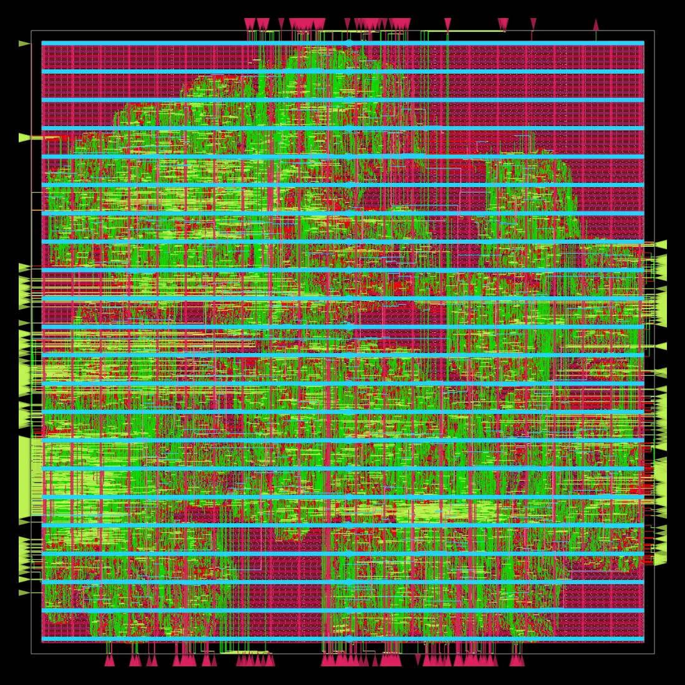</a>
</td>
<td align="justify" valign="middle">
  <strong>Visão geral do layout final</strong><br />
  Sobreposição das células, interconexões e estruturas de alimentação, mostrando a ocupação do núcleo e as conexões com os terminais externos.
</td>
</tr>
<tr>
<td align="center" valign="middle" width="45%">
  <a href="synth_org/top/reports/asap7/top/base/final_placement.webp">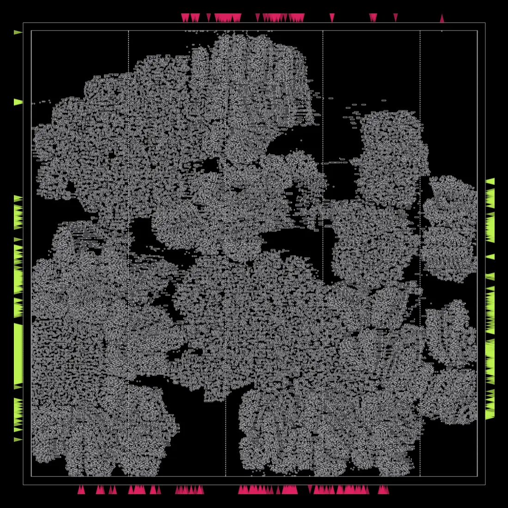</a>
</td>
<td align="justify" valign="middle">
  <strong>Posicionamento das células</strong><br />
  Distribuição das células padrão na área do núcleo. Permite observar regiões ocupadas e espaços disponíveis entre os agrupamentos.
</td>
</tr>
<tr>
<td align="center" valign="middle" width="45%">
  <a href="synth_org/top/reports/asap7/top/base/final_routing.webp">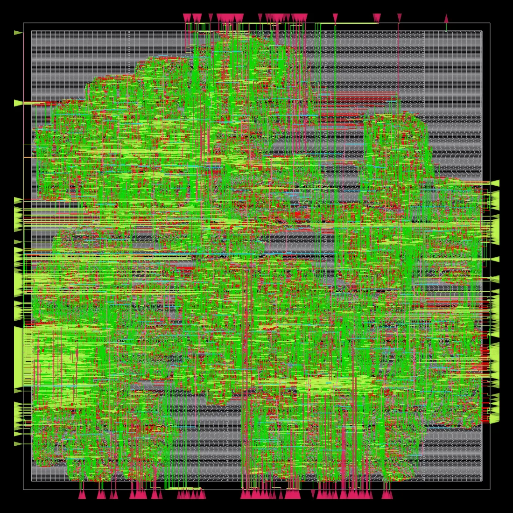</a>
</td>
<td align="justify" valign="middle">
  <strong>Roteamento final</strong><br />
  Interconexões entre as células e os terminais, representadas pelas cores das camadas de roteamento habilitadas na visualização.
</td>
</tr>
<tr>
<td align="center" valign="middle" width="45%">
  <a href="synth_org/top/reports/asap7/top/base/final_congestion.webp">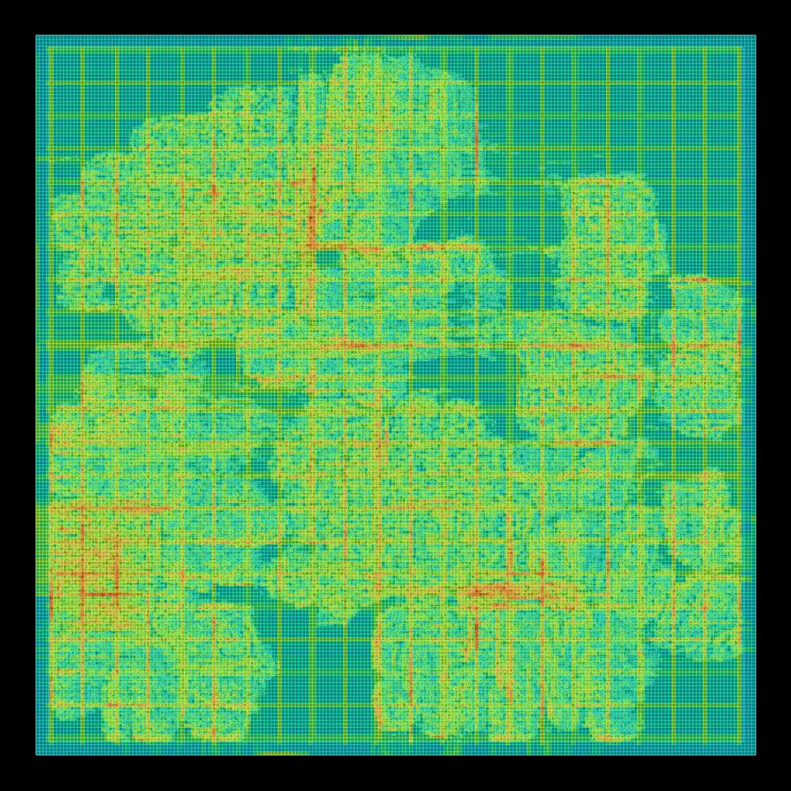</a>
</td>
<td align="justify" valign="middle">
  <strong>Congestionamento de roteamento</strong><br />
  Mapa da distribuição espacial de congestionamento, útil para localizar regiões de maior demanda por recursos de interconexão.
</td>
</tr>
<tr>
<td align="center" valign="middle" width="45%">
  <a href="synth_org/top/reports/asap7/top/base/final_ir_drop.webp">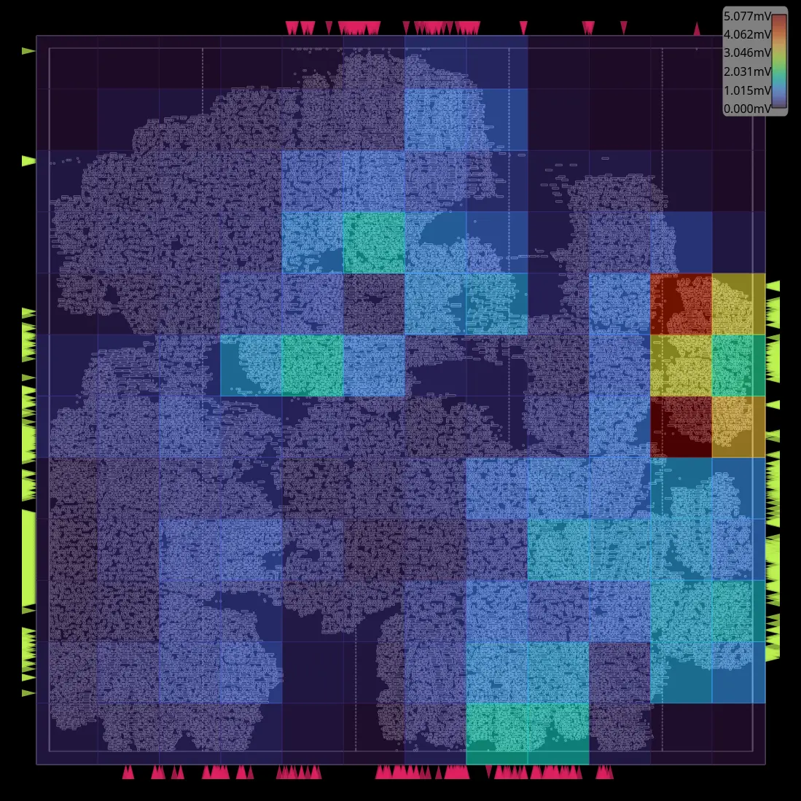</a>
</td>
<td align="justify" valign="middle">
  <strong>Queda de tensão na alimentação</strong><br />
  Mapa da queda de tensão estimada na rede de alimentação. A escala da própria figura está em milivolts.
</td>
</tr>
<tr>
<td align="center" valign="middle" width="45%">
  <a href="synth_org/top/reports/asap7/top/base/final_clocks.webp">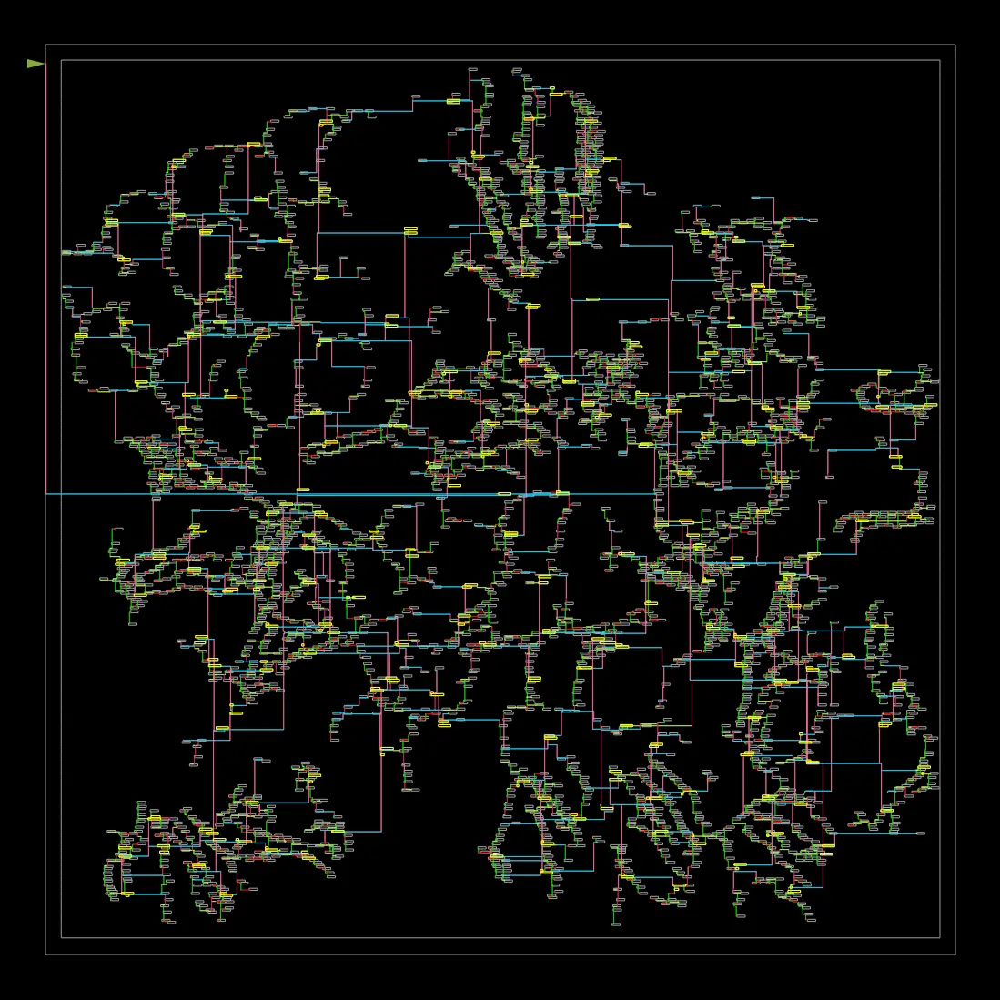</a>
</td>
<td align="justify" valign="middle">
  <strong>Rede de distribuição de clock</strong><br />
  Células e conexões da rede de clock destacadas no núcleo, permitindo acompanhar sua distribuição espacial.
</td>
</tr>
<tr>
<td align="center" valign="middle" width="45%">
  <a href="synth_org/top/reports/asap7/top/base/final_worst_path.webp">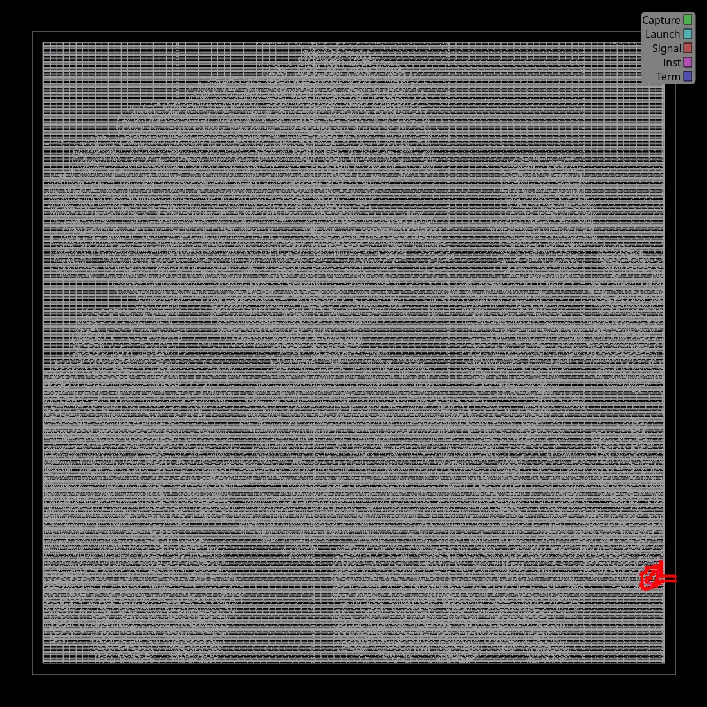</a>
</td>
<td align="justify" valign="middle">
  <strong>Caminho de timing destacado</strong><br />
  Trajeto selecionado pela análise temporal sobre o layout, com destaque para os trechos de lançamento, sinal e captura indicados na legenda.
</td>
</tr>
<tr>
<td align="center" valign="middle" width="45%">
  <a href="synth_org/top/reports/asap7/top/base/cts_default_core_clk.webp">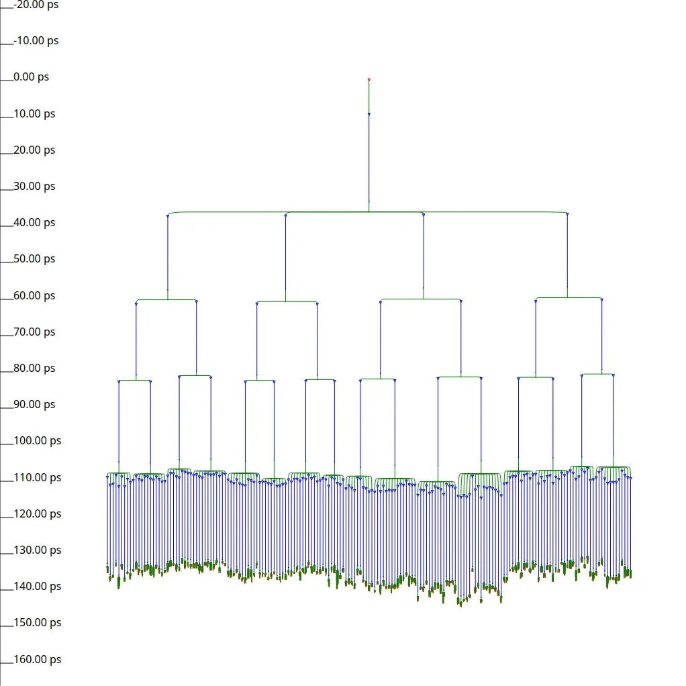</a>
</td>
<td align="justify" valign="middle">
  <strong>Árvore de clock core_clk</strong><br />
  Representação da ramificação da árvore de clock, com escala temporal em picosegundos para visualizar os níveis de distribuição.
</td>
</tr>
<tr>
<td align="center" valign="middle" width="45%">
  <a href="synth_org/top/reports/asap7/top/base/cts_default_core_clk_layout.webp">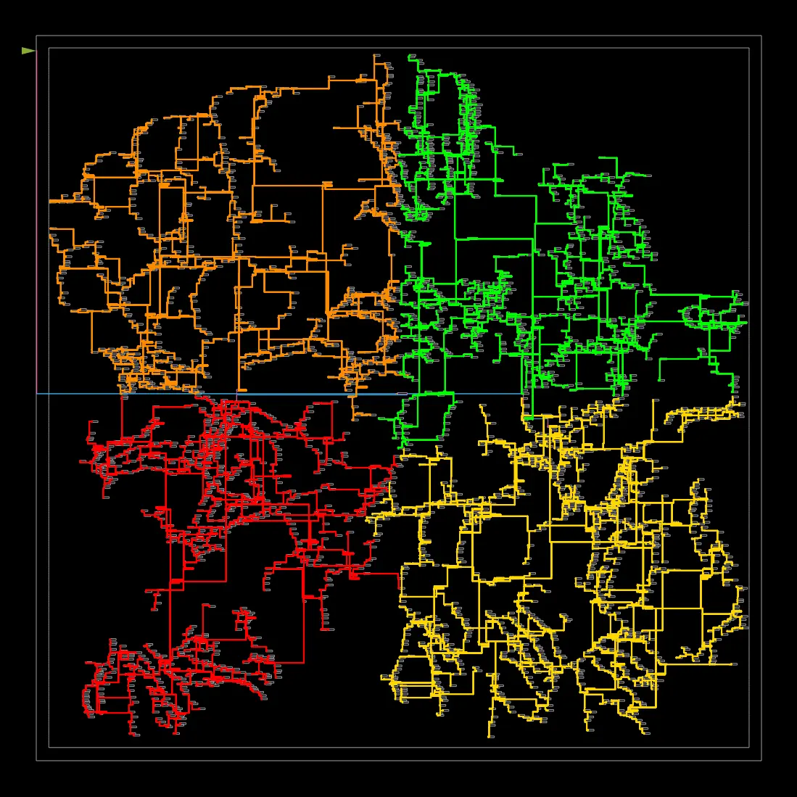</a>
</td>
<td align="justify" valign="middle">
  <strong>Árvore de clock no layout</strong><br />
  Distribuição física dos ramos da árvore de clock; as cores diferenciam os agrupamentos mostrados pela ferramenta.
</td>
</tr>
</tbody>
</table>

</div>
